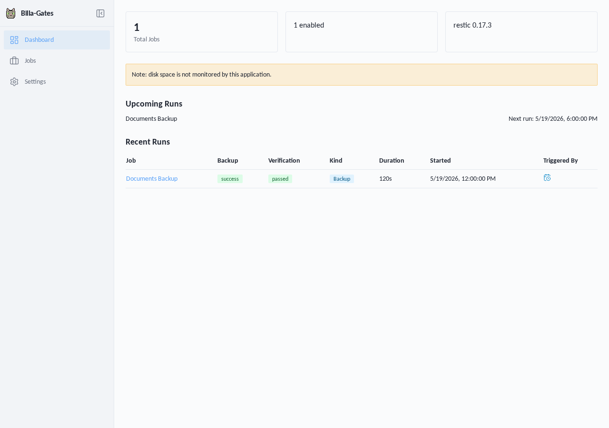
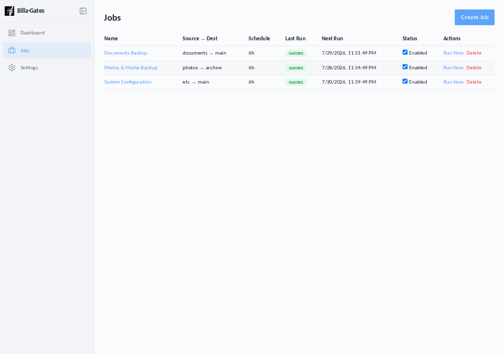
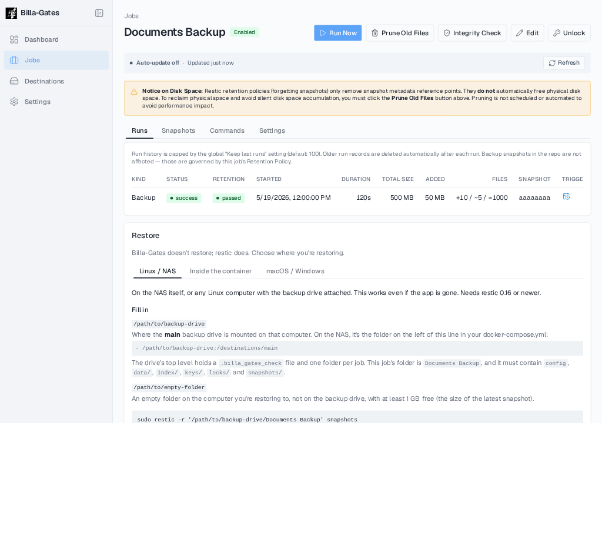
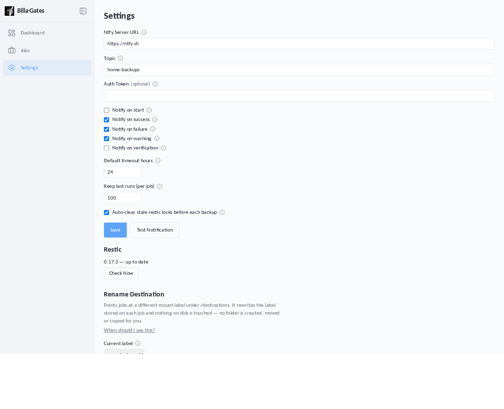

<p align="center">
  
</p>

# Billa-Gates

A web app for scheduled [restic](https://restic.net/) backups — create
backup jobs, run them on a schedule, apply retention, verify integrity, and get
notified.

> I have used AI tools (Claude Code, Antigravity). I use it to back up my NAS (photos,
> documents, logs). Please test (backup restore) for your own setup before relying on it, and
> open an issue if you find a bug.



## Features

- **Scheduled backups** — cron expressions or intervals (`30m`, `6h`, `1d`).
- **Retention** — `restic forget` runs after every backup; `restic prune` runs when you click
  **Prune Old Files** on the job page.
- **Integrity checks** — `restic check` (structural, subset or full) on demand from the job page.
- **Snapshots and run history** — read live from restic, alongside the exact restic commands each
  job runs.
- **Destinations page** — total, used and free space per backup drive.
- **Notifications** — run results pushed to ntfy.
- **Single container** — one image serves the API and the UI; state is one SQLite file.

## Screenshots

| Jobs                                         | Job detail                                              | Settings                                             |
| -------------------------------------------- | ------------------------------------------------------- | ---------------------------------------------------- |
|  |  |  |

## Deploy

Published images (`yash91sharma/billa-gates`) are **arm64 only**. For amd64, build your own —
see [deployment.md](deployment.md).

### 1. Mark your folders

Billa-Gates refuses to back up from, or to, a folder without a `.billa_gates_check` file at its
root. This is how a mounted drive is told apart from the empty directory a detached drive leaves
behind — without it, a missing drive would produce an empty snapshot and retention would then
delete the real ones.

```bash
touch /path/to/documents/.billa_gates_check     # every source
touch /path/to/backup-drive/.billa_gates_check  # every destination
```

Create the file on the drive or share itself, not on an empty mountpoint. If a run later fails
with a missing-sentinel error, the mount has most likely dropped, and check it before recreating the
file.

### 2. Start the container

```bash
mkdir -p billa-gates/data && cd billa-gates
```

`docker-compose.yml`:

```yaml
services:
  billa-gates:
    image: yash91sharma/billa-gates:latest
    container_name: billa-gates
    ports:
      - '12345:12345'
    environment:
      - TZ=America/Los_Angeles # timezone for cron schedules
    volumes:
      # Sources (read-only): one line per folder to back up.
      # The label after /sources/ is what the UI shows.
      - /path/to/documents:/sources/documents:ro
      # - /path/to/photos:/sources/photos:ro

      # Destinations (read-write): your backup drives.
      # Each job gets its own restic repository at /destinations/{label}/{job name}.
      - /path/to/backup-drive:/destinations/main

      # App state: SQLite DB and restic cache. Keep the /app/data side as is.
      - ./data:/app/data
    restart: unless-stopped
```

```bash
docker compose up -d
```

Open `http://<host>:12345`.

A job backs up a whole source mount. To back up a subfolder, mount it as its own source.

## Restore

Billa-Gates does not restore. Each repository is a plain restic repository at
`/destinations/{destination}/{job name}`, so any restic binary works — on the host with the drive
attached, or inside the container. The job page shows these commands with the path filled in:

```bash
docker exec -it billa-gates sh
export RESTIC_REPOSITORY=/destinations/main/<job name>
export RESTIC_PASSWORD=<job password>
restic snapshots
restic restore latest --target /destinations/main/restored   # any writable path
```

## Losing the database or a job

The repository path is derived from the job, not from the database. If `data/` is lost or a job
is deleted by mistake, create a job with the same **name**, **destination** and **password**: it
adopts the existing repository with every snapshot intact and retention still applying. That is
also why those three fields cannot be changed after creation.

Deleting a job leaves its repository on disk unless you tick **Also permanently delete the
repository** in the delete dialog.

## Destinations page

Figures are read from the filesystem when the page loads and again after every run — nothing is
stored.

- **Free** is what a backup can actually write and matches `df`'s `Avail`. Used + free is less
  than total because filesystems reserve blocks.
- The percentage is measured against total, so it reads a few points lower than `df`'s `Use%`. A
  drive can be 95% used with zero bytes free — plan against **Free**.
- Two labels on one drive are marked and not summed. restic deduplicates and compresses, so a
  source larger than the free space may still fit.

## Quirks

- **Interval schedules reset on restart.** `30m` / `6h` / `1d` count from application start, not
  from the last run. If the container restarts often, use a cron schedule instead.
- **One process, one worker.** Overlapping runs on a repository are prevented with in-memory
  locks. Running multiple Uvicorn workers or container replicas bypasses them and lets two
  processes write to the same repository at once.

## License

[MIT](LICENSE)
